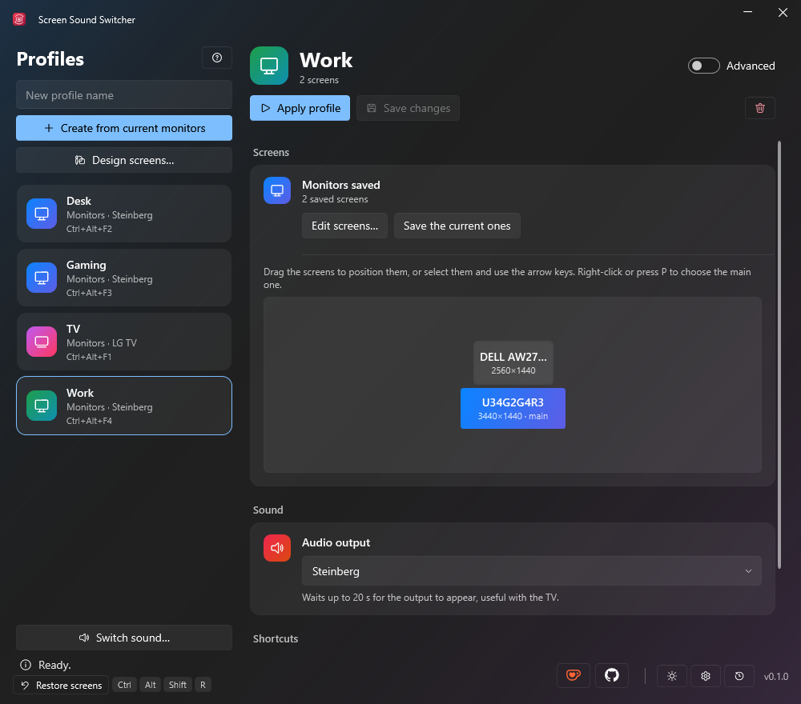
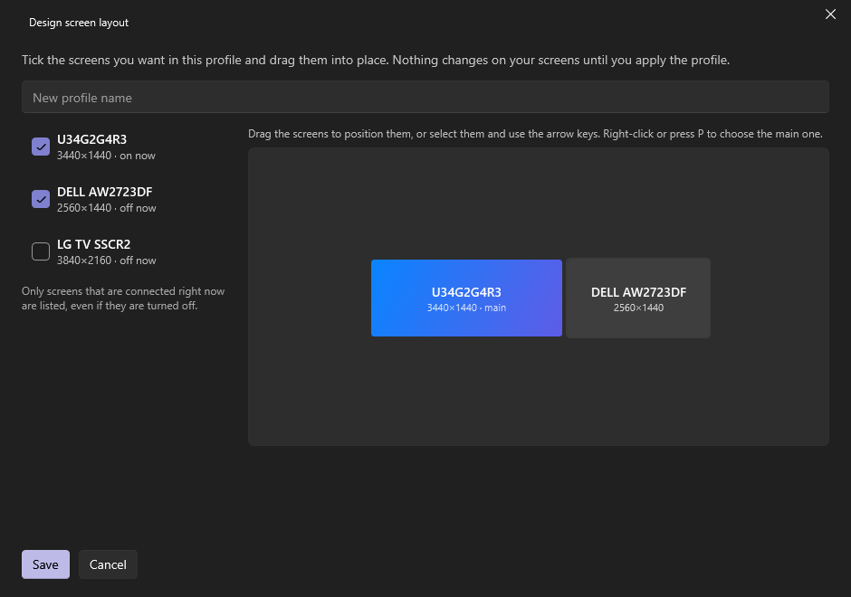

<div align="center">


# Screen Sound Switcher

<p><strong>Un clic, o un atajo, para cambiar todo tu escritorio: pantallas, salida de sonido, tele LG y programas. Una pequeña aplicación de bandeja para Windows.</strong></p>

[](../../releases)
[](https://steamcommunity.com/id/reptilemk/)
[](https://ko-fi.com/vitalies)
[](LICENSE)

[Descarga](#descarga) · [Compílalo tú mismo](#compílalo-tú-mismo) · [Apoyo](#apoya-el-proyecto) · [English](README.md) · **Español**



</div>

## Qué es

Una aplicación gratuita y no oficial para **Windows 10 y 11** que recuerda cómo tienes montado tu escritorio y lo deja así con un clic o un atajo. Un perfil guarda qué pantallas están encendidas y dónde, por qué salida suena el sonido, qué hace tu tele LG y qué programas se abren. Útil para pasar del escritorio al sofá, del trabajo a los juegos o de los altavoces a los auriculares.

Funciona en silencio desde la bandeja, también con la ventana cerrada, y lo guarda todo en tu PC: sin cuenta, sin nube, sin telemetría.

## Qué hace

- **Pantallas.** Guarda la disposición que tienes ahora, o diséñala en un lienzo sin tocar tus pantallas reales: marca los monitores (incluso los apagados), arrástralos a su sitio y guarda.
- **Sonido.** Elige la salida a la que cambia un perfil, o recorre tus favoritas con un solo atajo.
- **Tele LG (webOS).** Enciéndela (Wake-on-LAN), apágala y cambia su entrada, por tu red local.
- **Acciones extra.** Abre un programa, un enlace como `steam://open/bigpicture` o haz una llamada web (Home Assistant, enchufes inteligentes…).
- **Atajos.** Un atajo de teclado global por perfil y una combinación de botones en un mando tipo Xbox. Funcionan con la ventana cerrada.
- **Reglas automáticas.** Aplica un perfil o cambia la salida de sonido cuando se abre o se cierra un programa o una ventana, o cuando se enciende o apaga un auricular SteelSeries Arctis.
- **Segura por diseño.**
  - Un cambio de pantallas te pide confirmarlo y, si no lo haces, vuelve solo atrás. Tú eliges cuándo pregunta.
  - Si Windows reordena tus pantallas cuando una desaparece (por ejemplo, al apagar la tele), tu disposición se devuelve, sin parpadeos.
  - **Ctrl+Alt+Shift+R** restaura la última disposición que confirmaste, incluso con la ventana cerrada.
- **Difícil perder trabajo.** Los cambios sin guardar de un perfil se marcan, y se te pregunta antes de que se pierdan.
- **En tu idioma.** English, Español, Français, Deutsch, Português (Brasil), Italiano, Русский, Українська, 简体中文 y 日本語, con cambio en caliente. Tema claro y oscuro, y animaciones a tu gusto.



## Descarga

- **Descarga:** mira [Releases](../../releases) y elige una de las dos versiones:

  | Archivo                            | Tamaño      | Necesita                                                                         |
  | ---------------------------------- | ----------- | -------------------------------------------------------------------------------- |
  | `ScreenSoundSwitcher.exe`          | unos 9 MB   | el [.NET 10 Desktop Runtime](https://dotnet.microsoft.com/download/dotnet/10.0)  |
  | `ScreenSoundSwitcher-portable.exe` | unos 68 MB  | nada, lleva .NET dentro                                                          |

- **Instalación:** no hay nada que instalar, basta con ejecutarlo. Se actualiza solo desde las releases (dentro de su propia versión) y comprueba el SHA-256 que va junto a cada archivo antes de reemplazar nada.
- **SmartScreen:** los ejecutables aún no están firmados, así que Windows puede avisar la primera vez. Elige **Más información** y luego **Ejecutar de todas formas**. Puedes comparar antes el hash con el archivo `.sha256`.

### Primeros pasos

1. Coloca tus pantallas en Windows como quieres y pulsa **Crear con los monitores actuales**. O pulsa **Diseñar pantallas…** para montar una disposición sin cambiar nada ahora.
2. Elige la salida de sonido, la acción de la tele, el atajo… del perfil, y pulsa **Aplicar perfil** (arriba).
3. Aplícalo después desde la ventana, desde el icono de la bandeja o con su atajo.

Activa **Avanzado** para la tele, las acciones extra, el mando y las reglas automáticas.

<details>
<summary>Tele LG, acciones extra y reglas automáticas</summary>

### Tele LG

Funciona con webOS por tu red local. En *Conexión con la tele* indica la IP y la MAC de la tele y pulsa **Emparejar**; acepta el aviso que aparece en la tele. Para Wake-on-LAN, activa en la tele la opción de encenderla desde la red.

### Acciones extra

Una por línea, se aplican después de las pantallas y el sonido:

```text
"C:\Ruta\app.exe" --opcion
steam://open/bigpicture
GET https://host/ruta
POST https://host/ruta {"json":true}
```

### Reglas automáticas

*Reglas automáticas…* aplica un perfil (o una salida de sonido) cuando se abre un programa y otro cuando se cierra, por ejemplo Steam Big Picture → el perfil de la tele, y al cerrarlo volver a como estaba. Un programa se reconoce por el nombre de su proceso (`steam.exe`) o por parte del título de su ventana.

</details>

<details>
<summary>Seguridad de las pantallas, en detalle</summary>

Cambiar de pantallas puede dejarte con la imagen en negro, así que la app tiene tres redes:

- **Confirmación.** Cuando un perfil cambia las pantallas se te puede pedir que lo confirmes en unos segundos y, si no lo haces, vuelve la disposición anterior. En los ajustes (el engranaje) eliges cuándo: *siempre*, *solo si puedo quedarme sin imagen* (por defecto: solo cuando ninguna de las pantallas que estaban encendidas sigue encendida) o *nunca*.
- **Windows reordenándolas por su cuenta.** Si desaparece una pantalla, Windows suele reordenar las demás y puede encender otra. La app lo detecta y devuelve tu disposición, sin ruido y solo en ese caso: una pantalla que aparece, o un cambio que haces tú (Win+P, Configuración de pantalla), nunca se deshace. Espera a que los cambios se asienten, no hace nada si las pantallas ya están bien (así no parpadean) y se aparta si algo las sigue cambiando. Se puede desactivar en los ajustes.
- **Restauración de emergencia.** **Ctrl+Alt+Shift+R**, o el botón *Restaurar pantallas*, vuelve a la última disposición que confirmaste. Funciona con la ventana cerrada.

</details>

## Compílalo tú mismo

¿No quieres fiarte de un archivo ya compilado? Puedes compilar los mismos ejecutables desde este código.

<details>
<summary>Requisitos y pasos</summary>

### Requisitos

- Windows 10 u 11
- El [SDK de .NET 10](https://dotnet.microsoft.com/download/dotnet/10.0)
- git

### Compilar

```powershell
git clone https://github.com/vitaliesdev/screen-sound-switcher.git
cd screen-sound-switcher
dotnet publish src/MonitorTv.App -c Release -r win-x64 --self-contained false -p:PublishSingleFile=true
```

Eso genera `ScreenSoundSwitcher.exe` en `src/MonitorTv.App/bin/Release/net10.0-windows/win-x64/publish/`. Usa `--self-contained true` para la variante portable con .NET dentro.

### Versiones

Al subir una etiqueta como `v0.2.0`, el workflow de GitHub publica las dos variantes con su `.sha256`. La app usa esos archivos para actualizarse.

</details>

## Tus datos

Todo se guarda en tu PC, en `%AppData%\ScreenSoundSwitcher`: los perfiles (`Profiles\*.json`), `settings.json`, el emparejamiento de la tele (`tv.json`), la última disposición confirmada (`last-good.json`) y, si ocurre algo inesperado, `error.log`. No sale nada de tu ordenador salvo las llamadas que configures tú, la tele de tu red y la comprobación de actualizaciones en GitHub.

## Estructura del repositorio

| Ruta                          | Qué                                                                                          |
| ----------------------------- | -------------------------------------------------------------------------------------------- |
| `src/MonitorTv.App/`          | La app de Windows (WPF): ventanas, bandeja, atajos, mando, reglas, actualizador y el icono   |
| `src/MonitorTv.Core/`         | La lógica: pantallas (API de pantalla de Windows), sonido, tele LG, perfiles, ajustes y traducciones |
| `src/MonitorTv.Core/Strings/` | Un archivo JSON por idioma; el texto en español es la clave                                  |
| `src/MonitorTv.Cli/`          | Una pequeña herramienta de línea de órdenes para probar la lógica sin la interfaz            |
| `.github/workflows/`          | El workflow de publicación                                                                   |
| `docs/`                       | Capturas y el logo                                                                           |
| `PRODUCT.md` · `DESIGN.md`    | Para qué sirve la app y las decisiones de diseño                                             |

## Apoya el proyecto

Esta app es gratuita y la hago en mi tiempo libre. Si te ahorra tiempo, o simplemente te gusta, puedes ayudarme a seguir haciendo herramientas como esta.

[](https://ko-fi.com/vitalies)

Los errores y las ideas son bienvenidos en las [issues](../../issues).

## Créditos

- **Screen Sound Switcher:** REPTIX ([Steam](https://steamcommunity.com/id/reptilemk/))
- Hecho con [.NET](https://dotnet.microsoft.com/), [WPF UI](https://github.com/lepoco/wpfui), [NAudio](https://github.com/naudio/NAudio) y [HidSharp](https://www.zer7.com/software/hidsharp).
- Las marcas de Ko-fi y GitHub pertenecen a sus dueños.
- LG, webOS, SteelSeries, Arctis, Steam y Windows son marcas de sus dueños. Esta es una app no oficial, sin relación con ninguno de ellos ni respaldada por ellos.

## Licencia

[MIT](LICENSE)

<div align="center">

[GitHub](https://github.com/vitaliesdev) · [Steam](https://steamcommunity.com/id/reptilemk/) · [Ko-fi](https://ko-fi.com/vitalies)

Hecho por REPTIX · Vitalie

</div>
