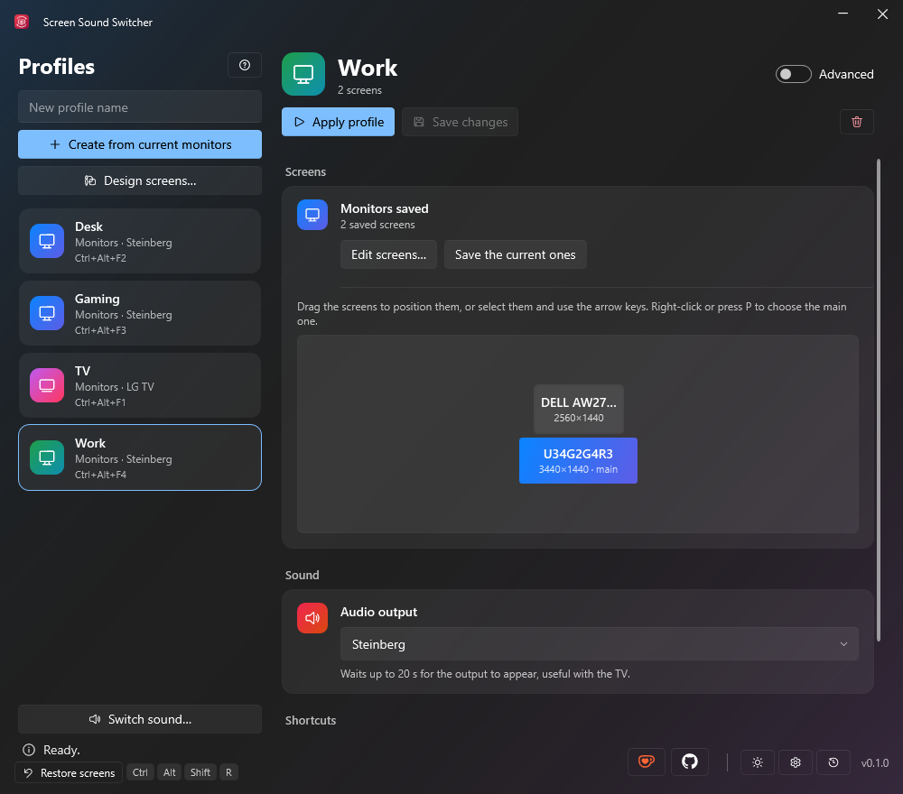
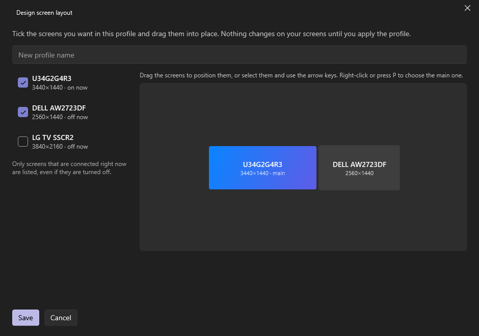

<div align="center">


# Screen Sound Switcher

<p><strong>One click, or one shortcut, to switch your whole desk: screens, sound output, LG TV and programs. A small Windows tray app.</strong></p>

[](../../releases)
[](https://steamcommunity.com/id/reptilemk/)
[](https://ko-fi.com/vitalies)
[](LICENSE)

[Download](#download) · [Build it yourself](#build-it-yourself) · [Support](#support-the-project) · **English** · [Español](README.es.md)



</div>

## About

A free, unofficial app for **Windows 10 and 11** that remembers how your desk is set up and puts it back with one click or one shortcut. A profile stores which screens are on and where they sit, which sound output plays, what your LG TV does and which programs start. Handy for going from desk to couch, from work to games, or from speakers to headset.

It runs quietly in the tray, works with the window closed and keeps everything on your PC: no account, no cloud, no telemetry.

## Features

- **Screens.** Save the layout you have now, or design one on a canvas without touching your real screens: tick the monitors (even ones that are off), drag them into place, save.
- **Sound.** Pick the output a profile switches to, or step through your favourites with a single shortcut.
- **LG TV (webOS).** Turn it on (Wake-on-LAN), turn it off and change its input, over your local network.
- **Extra actions.** Start a program, open a link such as `steam://open/bigpicture`, or make a web call (Home Assistant, smart plugs…).
- **Shortcuts.** A global keyboard shortcut per profile, and a button combination on an Xbox-style controller. Both work with the window closed.
- **Automatic rules.** Apply a profile or change the sound output when a program or window opens or closes, or when a SteelSeries Arctis headset is switched on or off.
- **Safe by design.**
  - A changed screen layout asks you to confirm and goes back by itself if you don't. You choose when it asks.
  - If Windows rearranges your screens when one disappears (the TV going off, say), your layout is put back, without flicker.
  - **Ctrl+Alt+Shift+R** restores the last layout you confirmed, even with the window closed.
- **Hard to lose work.** Unsaved changes to a profile are flagged, and you are asked before they would be thrown away.
- **Speaks your language.** English, Español, Français, Deutsch, Português (Brasil), Italiano, Русский, Українська, 简体中文 and 日本語, switched live. Light and dark theme, and your own choice about animations.



## Download

- **Download:** see [Releases](../../releases) and pick one of the two builds:

  | File                               | Size       | Needs                                                                            |
  | ---------------------------------- | ---------- | -------------------------------------------------------------------------------- |
  | `ScreenSoundSwitcher.exe`          | about 9 MB | the [.NET 10 Desktop Runtime](https://dotnet.microsoft.com/download/dotnet/10.0) |
  | `ScreenSoundSwitcher-portable.exe` | about 68 MB | nothing, .NET is inside                                                          |

- **Install:** there is nothing to install, just run it. It updates itself from the releases (within its own build) and checks the SHA-256 that sits next to each file before it replaces anything.
- **SmartScreen:** the executables are not code-signed yet, so Windows may warn the first time. Choose **More info**, then **Run anyway**. You can compare the hash with the `.sha256` file first.

### Quick start

1. Arrange your screens in Windows the way you want them and click **Create from current monitors**. Or click **Design screens…** to build a layout without changing anything now.
2. Choose the sound output, the TV action, the shortcut… for the profile, and click **Apply profile** (at the top).
3. Apply it later from the window, from the tray icon or with its shortcut.

Turn on **Advanced** for the TV, extra actions, the controller and the automatic rules.

<details>
<summary>LG TV, extra actions and automatic rules</summary>

### LG TV

Works with webOS over your local network. In *Connection with the TV* enter the TV's IP address and MAC address and click **Pair**; accept the prompt that appears on the TV. For Wake-on-LAN, turn on the TV's option to switch it on from the network.

### Extra actions

One per line, applied after the screens and the sound:

```text
"C:\Path\to\app.exe" --option
steam://open/bigpicture
GET https://host/path
POST https://host/path {"json":true}
```

### Automatic rules

*Automatic rules…* applies a profile (or a sound output) when a program starts and another when it closes, for example Steam Big Picture → the TV profile, and back to how things were when it closes. A program is recognised by its process name (`steam.exe`) or by part of its window title.

</details>

<details>
<summary>Screen safety, in detail</summary>

Changing screens can leave you with a black picture, so the app has three nets:

- **Confirmation.** When a profile changes the screens you can be asked to confirm within a few seconds, and if you don't, the previous layout comes back. In the settings (the gear) you choose when: *always*, *only if I could be left without a picture* (the default: only when none of the screens that were on stays on) or *never*.
- **Windows rearranging them by itself.** If a screen disappears, Windows often rearranges the rest and may switch another one on. The app notices and puts your layout back, quietly, and only in that case: a screen that appears, or a change you make yourself (Win+P, Display settings), is never undone. It waits for the changes to settle, does nothing when the screens are already right (so nothing flickers) and steps aside if something keeps changing them back. You can turn it off in the settings.
- **Emergency restore.** **Ctrl+Alt+Shift+R**, or the *Restore screens* button, goes back to the last layout you confirmed. It works with the window closed.

</details>

## Build it yourself

Don't want to trust a prebuilt file? You can build the same executables from this source.

<details>
<summary>Requirements and build steps</summary>

### Requirements

- Windows 10 or 11
- The [.NET 10 SDK](https://dotnet.microsoft.com/download/dotnet/10.0)
- git

### Build

```powershell
git clone https://github.com/vitaliesdev/screen-sound-switcher.git
cd screen-sound-switcher
dotnet publish src/MonitorTv.App -c Release -r win-x64 --self-contained false -p:PublishSingleFile=true
```

That generates `ScreenSoundSwitcher.exe` in `src/MonitorTv.App/bin/Release/net10.0-windows/win-x64/publish/`. Use `--self-contained true` to build the portable variant with .NET inside.

### Releases

Pushing a tag such as `v0.2.0` makes the GitHub workflow publish both variants with their `.sha256`. The app uses those files to update itself.

</details>

## Your data

Everything is stored on your PC in `%AppData%\ScreenSoundSwitcher`: the profiles (`Profiles\*.json`), `settings.json`, the TV pairing (`tv.json`), the last confirmed layout (`last-good.json`) and, if something unexpected happens, `error.log`. Nothing leaves your computer except the calls you set up yourself, the TV on your network and the check for updates on GitHub.

## Repository layout

| Path                    | What                                                                                              |
| ----------------------- | ------------------------------------------------------------------------------------------------- |
| `src/MonitorTv.App/`    | The Windows app (WPF): windows, tray, shortcuts, controller, rules, updater and the icon          |
| `src/MonitorTv.Core/`   | The logic: screens (Windows display API), sound, LG TV, profiles, settings and the translations   |
| `src/MonitorTv.Core/Strings/` | One JSON file per language; the Spanish text is the key                                     |
| `src/MonitorTv.Cli/`    | A small command-line tool used to try the core without the interface                              |
| `.github/workflows/`    | The release workflow                                                                              |
| `docs/`                 | Screenshots and the logo                                                                          |
| `PRODUCT.md` · `DESIGN.md` | What the app is for and the design decisions behind it                                         |

## Support the project

This app is free and made in my spare time. If it saved you time, or you simply enjoy it, you can help me keep making tools like this.

[](https://ko-fi.com/vitalies)

Bug reports and ideas are welcome in the [issues](../../issues).

## Credits

- **Screen Sound Switcher:** REPTIX ([Steam](https://steamcommunity.com/id/reptilemk/))
- Built with [.NET](https://dotnet.microsoft.com/), [WPF UI](https://github.com/lepoco/wpfui), [NAudio](https://github.com/naudio/NAudio) and [HidSharp](https://www.zer7.com/software/hidsharp).
- The Ko-fi and GitHub marks belong to their owners.
- LG, webOS, SteelSeries, Arctis, Steam and Windows are trademarks of their owners. This is an unofficial app, not affiliated with or endorsed by any of them.

## Licence

[MIT](LICENSE)

<div align="center">

[GitHub](https://github.com/vitaliesdev) · [Steam](https://steamcommunity.com/id/reptilemk/) · [Ko-fi](https://ko-fi.com/vitalies)

Made by REPTIX · Vitalie

</div>
